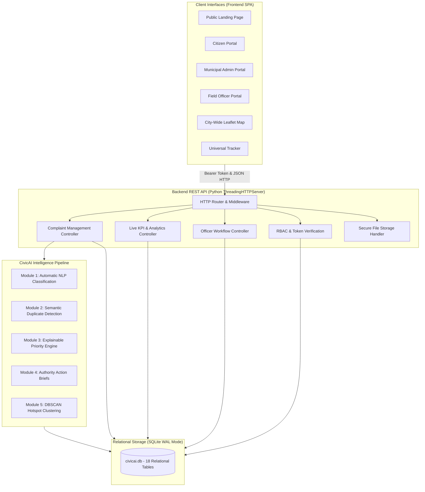

# CivicAI - System Architecture

## 1. High-Level System Architecture

CivicAI is engineered with a layered, decoupled architecture ensuring that all user roles interact through a shared, secure REST API and persistent relational database layer.

---

## 2. Role-Based Access Control (RBAC) Matrix

| Capability | Public / Visitor | Citizen | Field Officer | Municipal Admin |
| :--- | :---: | :---: | :---: | :---: |
| View Public Landing & Live Stats | Yes | Yes | Yes | Yes |
| Track Issue by ID | Yes | Yes | Yes | Yes |
| Lodge Complaint with GPS & Photos | No | Yes | Yes | Yes |
| View Personal Lodged Complaints | No | Yes | No | Yes |
| Reopen Complaint / Submit Rating | No | Yes | No | Yes |
| In-App Notification Center | No | Yes | Yes | Yes |
| Access Admin Dashboard & KPIs | No | No | No | Yes |
| Override AI Priority / Level | No | No | No | Yes |
| Link / Reject Duplicate Reports | No | No | No | Yes |
| Assign Department & Field Officer | No | No | No | Yes |
| Export Data to CSV | No | No | No | Yes |
| Reset Demo Database State | No | No | No | Yes |
| View Assigned Work Queue | No | No | Yes | Yes |
| Accept On-Site Assignment | No | No | Yes | Yes |
| Submit Resolution Evidence Photos | No | No | Yes | Yes |

---

## 3. Data Integrity & Concurrency

- **Database Engine**: SQLite 3 with Write-Ahead Logging (`PRAGMA journal_mode = WAL;`) and Foreign Key enforcement (`PRAGMA foreign_keys = ON;`).
- **Connection Management**: Thread-safe connection pooling via context managers with automatic commit and rollback on errors.
- **Security**: PBKDF2-HMAC-SHA256 password hashing with 100,000 iterations and unique cryptographic salts. Session tokens are signed using HMAC-SHA256 with 72-hour expiration.
