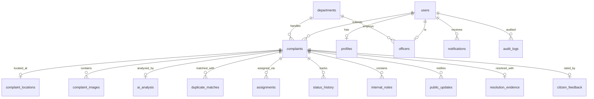

# CivicAI - Database Schema Specification

The CivicAI database is a normalized relational schema with 18 distinct tables, strict foreign key constraints, indexes, and comprehensive audit trails.

---

## Entity Relationship Overview

---

## Table Definitions

### 1. `users`
Core user identity for citizens, administrators, and field officers.
- `id` (INTEGER, PK, AUTOINCREMENT)
- `email` (TEXT, UNIQUE, NOT NULL)
- `password_hash` (TEXT, NOT NULL)
- `role` (TEXT, CHECK: 'citizen', 'admin', 'officer')
- `full_name` (TEXT, NOT NULL)
- `phone` (TEXT)
- `is_active` (INTEGER, DEFAULT 1)
- `created_at` (TIMESTAMP)
- `updated_at` (TIMESTAMP)

### 2. `profiles`
Extended profile information for all user types.
- `user_id` (INTEGER, PK, FK -> users.id)
- `avatar_url` (TEXT)
- `department_id` (INTEGER, FK -> departments.id)
- `badge_number` (TEXT)
- `address` (TEXT)
- `emergency_contact` (TEXT)
- `bio` (TEXT)
- `updated_at` (TIMESTAMP)

### 3. `departments`
Municipal departments responsible for issue resolution.
- `id` (INTEGER, PK, AUTOINCREMENT)
- `name` (TEXT, UNIQUE, NOT NULL)
- `code` (TEXT, UNIQUE, NOT NULL)
- `description` (TEXT)
- `contact_email` (TEXT)
- `head_name` (TEXT)
- `active_officers_count` (INTEGER, DEFAULT 0)
- `sla_hours` (INTEGER, DEFAULT 48)
- `created_at` (TIMESTAMP)

### 4. `officers`
Specialized municipal field inspectors and crews.
- `id` (INTEGER, PK, AUTOINCREMENT)
- `user_id` (INTEGER, UNIQUE, FK -> users.id)
- `department_id` (INTEGER, FK -> departments.id)
- `badge_number` (TEXT, UNIQUE, NOT NULL)
- `rank` (TEXT, DEFAULT 'Field Inspector')
- `status` (TEXT, CHECK: 'available', 'on_field', 'off_duty')
- `total_assigned` (INTEGER, DEFAULT 0)
- `total_resolved` (INTEGER, DEFAULT 0)
- `created_at` (TIMESTAMP)

### 5. `complaints`
Primary civic incident entity.
- `id` (INTEGER, PK, AUTOINCREMENT)
- `tracking_id` (TEXT, UNIQUE, NOT NULL) - e.g. `CIV-2026-1001`
- `user_id` (INTEGER, FK -> users.id)
- `title` (TEXT, NOT NULL)
- `description` (TEXT, NOT NULL)
- `category` (TEXT, NOT NULL)
- `subcategory` (TEXT, NOT NULL)
- `priority` (TEXT, CHECK: 'critical', 'high', 'medium', 'low')
- `status` (TEXT, CHECK: 'submitted', 'ai_analyzed', 'under_review', 'assigned', 'in_progress', 'resolved', 'closed', 'reopened', 'rejected', 'more_info_required', 'duplicate_linked')
- `department_id` (INTEGER, FK -> departments.id)
- `assigned_officer_id` (INTEGER, FK -> officers.id)
- `created_at` (TIMESTAMP)
- `updated_at` (TIMESTAMP)
- `resolved_at` (TIMESTAMP)
- `public_notes` (TEXT)

### 6. `complaint_locations`
Precise geographic location data.
- `complaint_id` (INTEGER, PK, FK -> complaints.id)
- `latitude` (REAL, NOT NULL)
- `longitude` (REAL, NOT NULL)
- `address` (TEXT, NOT NULL)
- `landmark` (TEXT)
- `ward` (TEXT)
- `postal_code` (TEXT)

### 7. `complaint_images`
Citizen-uploaded and system photos.
- `id` (INTEGER, PK, AUTOINCREMENT)
- `complaint_id` (INTEGER, FK -> complaints.id)
- `image_url` (TEXT, NOT NULL)
- `image_type` (TEXT, CHECK: 'report', 'before', 'after')
- `caption` (TEXT)
- `uploaded_at` (TIMESTAMP)

### 8. `ai_analysis`
Complete AI triage scores, action briefs, and classification records.
- `id` (INTEGER, PK, AUTOINCREMENT)
- `complaint_id` (INTEGER, UNIQUE, FK -> complaints.id)
- `category` (TEXT)
- `subcategory` (TEXT)
- `department` (TEXT)
- `short_summary` (TEXT)
- `keywords` (TEXT)
- `urgency` (TEXT)
- `confidence` (REAL)
- `safety_score` (REAL)
- `public_impact_score` (REAL)
- `urgency_score` (REAL)
- `concentration_score` (REAL)
- `frequency_score` (REAL)
- `total_priority_score` (REAL)
- `priority_level` (TEXT)
- `action_brief` (TEXT)
- `human_reviewed` (INTEGER, DEFAULT 0)
- `reviewed_by` (INTEGER, FK -> users.id)
- `created_at` (TIMESTAMP)

### 9. `duplicate_matches`
Cross-complaint duplicate evaluations.
- `id` (INTEGER, PK, AUTOINCREMENT)
- `primary_complaint_id` (INTEGER, FK -> complaints.id)
- `duplicate_complaint_id` (INTEGER, FK -> complaints.id)
- `similarity_score` (REAL, NOT NULL)
- `geo_distance_m` (REAL, NOT NULL)
- `status` (TEXT, CHECK: 'potential', 'confirmed', 'rejected')
- `explanation` (TEXT)
- `detected_at` (TIMESTAMP)

### 10. `hotspot_clusters`
DBSCAN-detected municipal geographic clusters.
- `id` (INTEGER, PK, AUTOINCREMENT)
- `cluster_name` (TEXT, NOT NULL)
- `center_lat` (REAL, NOT NULL)
- `center_lng` (REAL, NOT NULL)
- `radius_km` (REAL, NOT NULL)
- `complaint_count` (INTEGER, DEFAULT 0)
- `dominant_category` (TEXT)
- `severity_level` (TEXT)
- `complaint_ids_json` (TEXT)
- `updated_at` (TIMESTAMP)

### 11. `assignments`
Administrative task dispatches to field inspectors.
- `id` (INTEGER, PK, AUTOINCREMENT)
- `complaint_id` (INTEGER, FK -> complaints.id)
- `officer_id` (INTEGER, FK -> officers.id)
- `assigned_by` (INTEGER, FK -> users.id)
- `assigned_at` (TIMESTAMP)
- `status` (TEXT, CHECK: 'pending', 'accepted', 'in_progress', 'completed', 'reassigned')
- `notes` (TEXT)

### 12. `status_history`
Immutable audit log tracking every milestone in a complaint's lifecycle.
- `id` (INTEGER, PK, AUTOINCREMENT)
- `complaint_id` (INTEGER, FK -> complaints.id)
- `previous_status` (TEXT)
- `new_status` (TEXT, NOT NULL)
- `changed_by` (INTEGER, FK -> users.id)
- `user_role` (TEXT, NOT NULL)
- `timestamp` (TIMESTAMP)
- `explanation` (TEXT)
- `is_public` (INTEGER, DEFAULT 1)

### 13. `internal_notes`
Internal administrative and field crew notes (restricted from citizen view).
- `id` (INTEGER, PK, AUTOINCREMENT)
- `complaint_id` (INTEGER, FK -> complaints.id)
- `author_id` (INTEGER, FK -> users.id)
- `note_text` (TEXT, NOT NULL)
- `created_at` (TIMESTAMP)

### 14. `public_updates`
Public announcements and status messages displayed on the citizen tracker.
- `id` (INTEGER, PK, AUTOINCREMENT)
- `complaint_id` (INTEGER, FK -> complaints.id)
- `author_id` (INTEGER, FK -> users.id)
- `message` (TEXT, NOT NULL)
- `update_type` (TEXT)
- `created_at` (TIMESTAMP)

### 15. `notifications`
In-app citizen and officer notification messages.
- `id` (INTEGER, PK, AUTOINCREMENT)
- `user_id` (INTEGER, FK -> users.id)
- `complaint_id` (INTEGER, FK -> complaints.id)
- `title` (TEXT, NOT NULL)
- `message` (TEXT, NOT NULL)
- `type` (TEXT, DEFAULT 'info')
- `is_read` (INTEGER, DEFAULT 0)
- `created_at` (TIMESTAMP)

### 16. `resolution_evidence`
Verified Before & After photos, labor hours, and summary from the field.
- `id` (INTEGER, PK, AUTOINCREMENT)
- `complaint_id` (INTEGER, UNIQUE, FK -> complaints.id)
- `officer_id` (INTEGER, FK -> officers.id)
- `before_image_url` (TEXT)
- `after_image_url` (TEXT)
- `resolution_summary` (TEXT, NOT NULL)
- `equipment_used` (TEXT)
- `labor_hours` (REAL, DEFAULT 0.0)
- `resolved_at` (TIMESTAMP)

### 17. `citizen_feedback`
Citizen satisfaction ratings and reopen requests.
- `id` (INTEGER, PK, AUTOINCREMENT)
- `complaint_id` (INTEGER, UNIQUE, FK -> complaints.id)
- `user_id` (INTEGER, FK -> users.id)
- `rating` (INTEGER, CHECK: 1 <= rating <= 5)
- `comments` (TEXT)
- `reopen_requested` (INTEGER, DEFAULT 0)
- `created_at` (TIMESTAMP)

### 18. `audit_logs`
System-wide security and operational activity ledger.
- `id` (INTEGER, PK, AUTOINCREMENT)
- `user_id` (INTEGER, FK -> users.id)
- `action` (TEXT, NOT NULL)
- `resource_type` (TEXT, NOT NULL)
- `resource_id` (TEXT)
- `details` (TEXT)
- `ip_address` (TEXT)
- `timestamp` (TIMESTAMP)
